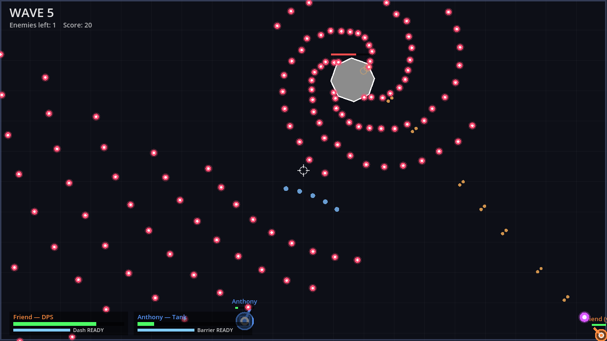

# Top-Down Arena

A co-op top-down bullet hell for two players over the network. Pick a role, then
survive endless waves of enemies with a boss every 5th wave.



Built with [Godot 4.3](https://godotengine.org/download). No art assets; everything is drawn in code.

## Roles

| Role | HP | Weapon | Ability (Space / Right click) |
|---|---|---|---|
| **Tank** | 240 | Short-range 5-pellet shotgun | **Barrier** (12 s cooldown): a 4 s bubble that deletes enemy bullets. Enemies prefer to target the tank. |
| **Healer** | 120 | Single bolt | **Mend Pulse** (10 s): heals everyone nearby for 60 and instantly revives downed allies in range. Passive aura slowly heals an ally standing close. |
| **DPS** | 95 | Fast twin-stream rifle | **Dash** (3.5 s): quick dash with brief invulnerability. |

Both players can pick the same role if you want.

## Rules

- Your hitbox is the small white dot in the middle of your character, not the whole circle.
- At 0 HP you're **downed**. Stand next to a downed ally for 3 seconds to revive them (or the healer can pulse them back).
- If both players are downed, it's game over. Clearing a wave revives anyone downed and heals everyone a bit.
- New enemy types unlock as waves go up: grunts (aimed spreads), bursters (rings), snipers (fast shots), spinners (spirals), and a boss every 5 waves.

## Controls

| | |
|---|---|
| Move | WASD / arrow keys |
| Aim | Mouse |
| Shoot | Hold left click |
| Ability | Space or right click |
| Leave | Esc |
| After game over (host) | R = play again, L = back to lobby |

## Playing with a friend

One person **hosts**, the other **joins**. The host's game acts as the server, so you don't need anything else.

1. Both of you install [Tailscale](https://tailscale.com/download) (free) and join the same tailnet. The host shares their machine with the friend, or you both sign into one account.
2. Host: open the game, click **Host game**. The lobby lists your addresses; give your friend the one starting with `100.`.
3. Friend: type that address into **Host address**, click **Join game**.
4. Both pick a role; the host clicks **Start game**.

Without Tailscale, the host can instead forward **UDP port 7777** on their router to their PC and give the friend their public IP. On the same Wi-Fi, just use the host's local `192.168.x.x` address.

## Making a .exe to send to your friend

1. Open the project in Godot 4.3.
2. **Editor → Manage Export Templates → Download and Install** (one time).
3. **Project → Export…** → the *Windows Desktop* preset is already set up → **Export Project**. You get a single `build/TopDownArena.exe`.
4. Send that file. On first launch Windows may say "Windows protected your PC"; click **More info → Run anyway** (the game isn't code-signed).

## Testing tricks

Command-line flags (after `--`) let you test without clicking through menus:

```
godot --path . -- --host --role=tank --autostart=2      # host and auto-start when a friend joins
godot --path . -- --join=127.0.0.1 --role=dps           # join a local host
```

Also: `--name=X`, `--start-wave=N` (jump ahead), `--bot` (player moves and shoots by itself), `--log` (print host stats).

## Code layout

- `scripts/main.gd`: menu, lobby, connecting and role selection
- `scripts/game.gd`: the match: host simulation (enemies, bullets, waves, damage), network sync, and drawing
- `scripts/roles.gd`: role stats; tweak numbers here to rebalance
